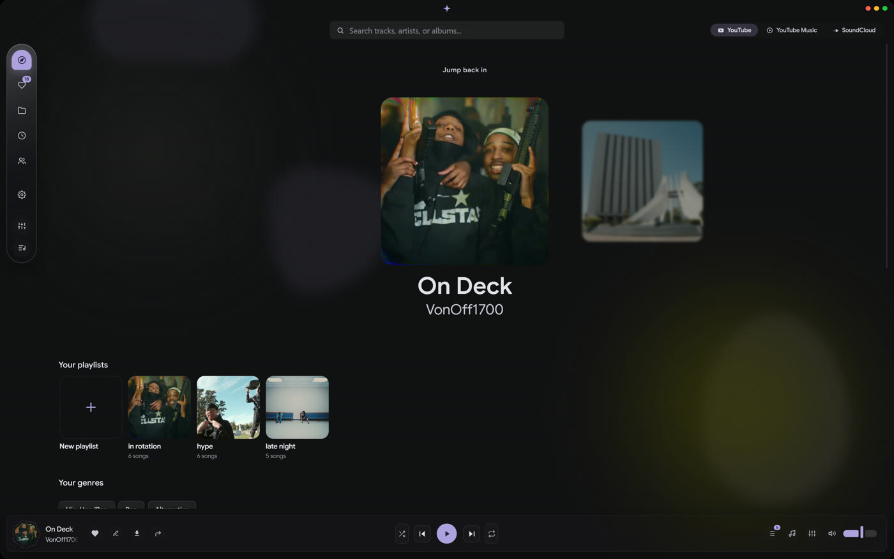
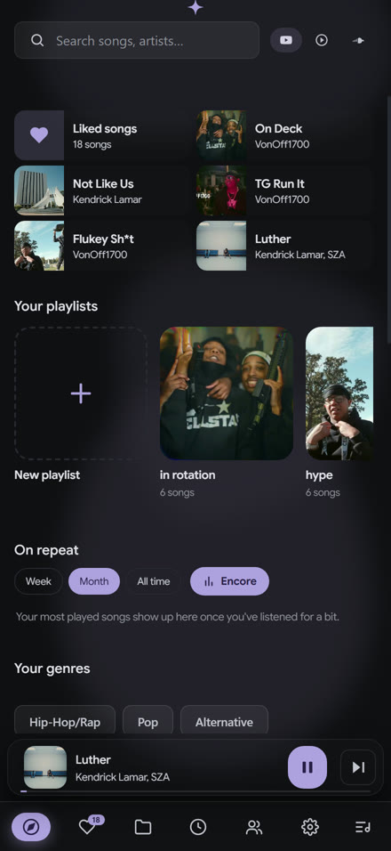
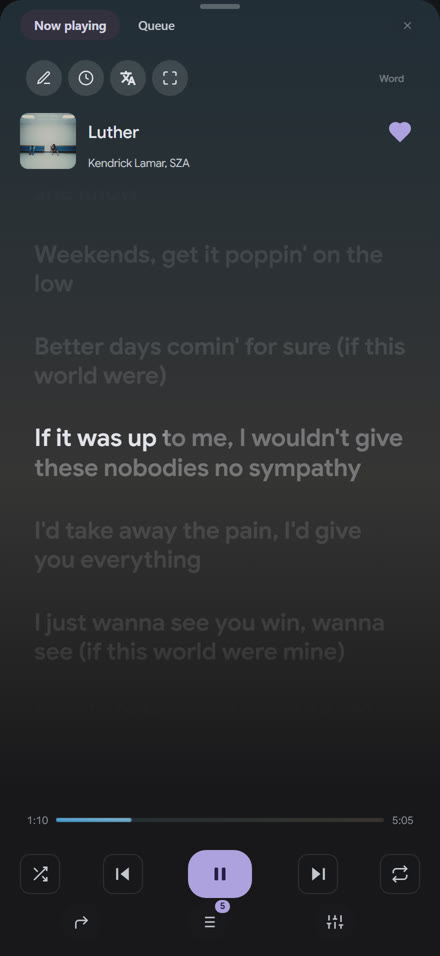
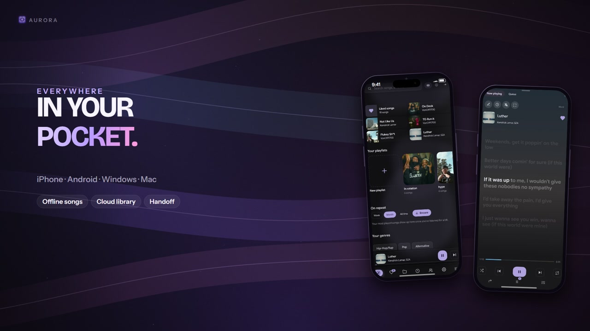

  

<h1 align="center">Aurora</h1>

  <strong>All your music. None of the strings.</strong> 
  A free player for YouTube, YouTube Music and SoundCloud — on iPhone, Android, Windows, macOS and Linux.

  <a href="https://bannedvariable.github.io/aurora/#download"><strong>Download</strong></a>
  &nbsp;·&nbsp;
  <a href="https://bannedvariable.github.io/aurora/">Website</a>
  &nbsp;·&nbsp;
  <a href="https://github.com/BannedVariable/BannedVariable.github.io/releases">Releases</a>
  &nbsp;·&nbsp;
  <a href="https://github.com/BannedVariable/BannedVariable.github.io/issues/new?template=bug_report.yml">Report a bug</a>

  
  
  
  

  

> [!IMPORTANT]
> **This is Aurora's public home, not its source code.**
> Aurora is free to use, but it is **not open source**. The app's source lives in a private repository. This repository holds the website, the release downloads and the issue tracker.

## One player. Every screen.

Aurora plays YouTube, YouTube Music and SoundCloud in one library. No ads, no subscription and no premium tier — just the music you already listen to, with the features a player should have.

| Listen | Move |
| --- | --- |
| **Synced lyrics** Word-by-word karaoke, translations, a fullscreen sing-along mode and an editor for your own timing. | **Every screen** iPhone, Android, Windows, macOS and Linux, with one library across all of them. |
| **Offline listening** Songs you play stay on your device for the train or airplane mode. | **Handoff** Start on your phone, open Aurora on your desktop and keep the same second. |
| **A desktop island** A transparent Dynamic Island overlay that floats above other apps. | **Desktop extras** EQ, effects, crossfade, sleep timer, MP3/FLAC downloads and plugins. |

Aurora 1.0 is out. New builds land often and some edges are still rough. It is an independent, non-commercial project.

## The app, not a mockup

  
  &nbsp;&nbsp;&nbsp;
  

Real screenshots from the iOS and Android apps. Your library stays yours.

## See it in motion

A 24-second cut through the player, the lyrics, the island and handoff. The website plays it with sound on demand.

## Download

The latest builds for every platform. The website has the full install guide, screenshots and a live download counter.

| Platform | Install | Notes |
| --- | --- | --- |
| **Windows** | [Aurora.exe](https://github.com/BannedVariable/BannedVariable.github.io/releases/download/windows-latest/Aurora.exe) | x64 installer. If SmartScreen appears: **More info → Run anyway**. |
| **Android** | [Aurora.apk](https://github.com/BannedVariable/BannedVariable.github.io/releases/download/android-latest/Aurora.apk) | Signed APK. Allow installs from your browser when prompted. |
| **iPhone / iPad** | [Install guide](https://bannedvariable.github.io/aurora/#download) · [IPA](https://github.com/BannedVariable/BannedVariable.github.io/releases/download/ios-latest/Aurora.ipa) | SideStore or Sideloadly. Free signing lasts 7 days unless you use a paid developer account. |
| **Mac** | [Apple silicon](https://github.com/BannedVariable/BannedVariable.github.io/releases/download/v1.0.1/Aurora-1.0.1-mac-arm64.dmg) · [Intel](https://github.com/BannedVariable/BannedVariable.github.io/releases/download/v1.0.1/Aurora-1.0.1-mac-x64.dmg) | Unsigned: run `xattr -cr /Applications/Aurora.app` once if macOS says it is damaged. |
| **Linux** | [AppImage](https://github.com/BannedVariable/BannedVariable.github.io/releases/download/v1.0.1/aurora-1.0.1-linux-x86_64.AppImage) | `chmod +x` the file, then run it. Needs FUSE 2. |

[All releases →](https://github.com/BannedVariable/BannedVariable.github.io/releases) · [Full install guide →](https://bannedvariable.github.io/aurora/#download)

## New in 1.0.1

Automatic Windows updates, a cleaner Aurora first run, and the same version on every screen.

- **Windows updates itself** — 1.0.1 checks the release feed, downloads in the background, and offers Restart when the next build is ready.
- **One library, five platforms** — iPhone, Android, Windows, macOS and Linux.
- **Lyrics that follow the song** — word-by-word timing, translations and fullscreen karaoke.
- **A desktop player that stays out of the way** — the island, handoff, EQ, effects and offline downloads.

[Read the 1.0.1 release →](https://github.com/BannedVariable/BannedVariable.github.io/releases/tag/v1.0.1)

## What this repository is

| Path | What it is |
| --- | --- |
| [`aurora/`](aurora/) | The public website served at **bannedvariable.github.io/aurora** — HTML, CSS, JS, the promo film and its poster. |
| [`aurora/auth.html`](aurora/auth.html) | The Google sign-in return page used by the desktop and mobile apps. |
| [`assets/`](assets/) | Images used by this README. |
| [`.github/`](.github/) | Issue forms and repository configuration. |
| `index.html` | A redirect from the repository root to `/aurora/`. |

> **Looking for the app's source?** There isn't a public one. Nothing in `aurora/` is the player itself; it is the download site, the sign-in callback and the promo. The app's source is private and is not distributed here.

## Issues and help

This issue tracker is the public place to reach the project. The app repository is private, so bugs, install problems and feature ideas all start here.

| [**Report a bug**](https://github.com/BannedVariable/BannedVariable.github.io/issues/new?template=bug_report.yml) | [**Request a feature**](https://github.com/BannedVariable/BannedVariable.github.io/issues/new?template=feature_request.yml) | [**Ask a question**](https://github.com/BannedVariable/BannedVariable.github.io/issues/new?template=question.yml) |
| --- | --- | --- |
| Something is broken or looks wrong. | An idea that would make Aurora better. | Install help or a question about how something works. |

Before you post, include your platform, the Aurora version (**Settings → About**), what you did, what happened and what you expected. Screenshots, recordings or logs help a lot. Remove passwords, account tokens and private files before posting.

The [FAQ](https://bannedvariable.github.io/aurora/#faq) covers the common install questions first.

## Security

Please do not post security details in a public issue. Use [GitHub's private vulnerability reporting](https://github.com/BannedVariable/BannedVariable.github.io/security/advisories/new) and include the platform, version and steps to reproduce. If private reporting is unavailable, open a minimal issue asking for a private channel without including exploit details.

## Source and license

Aurora is **free to use, not open source**. This repository is public because the website and downloads need a stable public home, not because the app's source is available.

- The app's source is private and is not distributed here.
- No source license is granted by this repository.
- The website files in `aurora/` are published so the site can be served; they are not the app.
- You are welcome to read the public site, report issues and request features.

## Legal

Aurora is an independent, non-commercial project. It is not affiliated with, endorsed by or sponsored by YouTube, Google, SoundCloud, Spotify, Apple or any record label. YouTube and YouTube Music are trademarks of Google LLC; SoundCloud, Spotify and Apple Music are trademarks of their owners and are named only to describe what Aurora works with.

Aurora hosts no music. It plays publicly available sources on your own device. Use it for private listening and only download content you have the right to keep.

  <a href="https://bannedvariable.github.io/aurora/">Website</a> · <a href="https://github.com/BannedVariable/BannedVariable.github.io/releases">Releases</a> · <a href="https://github.com/BannedVariable/BannedVariable.github.io/issues">Issues</a> · <a href="https://bannedvariable.github.io/aurora/sidestore.json">SideStore source</a>

